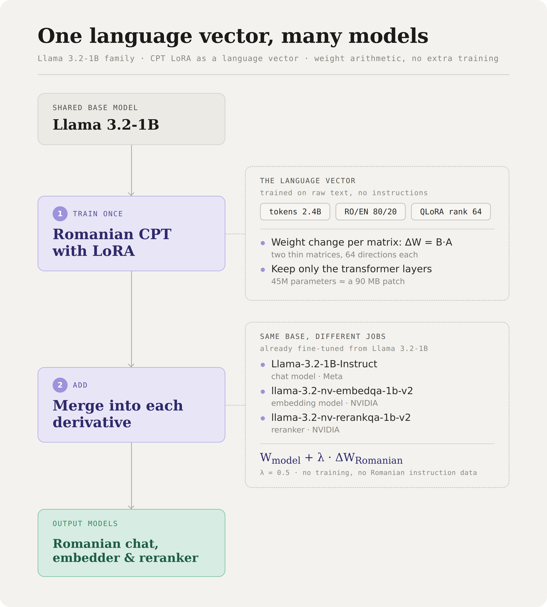

# RoLLM-CPT: Continual Pretraining of Llama-3.2-1B for Romanian

Adapts Llama-3.2-1B to Romanian through continual pretraining (CPT) with QLoRA, using a milestone-based training loop that evaluates Romanian and English signals at token checkpoints. The repo covers both recipe-selection experiments and two full 2.4B-token runs comparing unfiltered Romanian web data against its educational-value-filtered counterpart.

This repo accompanies two Substack posts:
- **[RoLlama3.2-1B : CPT of a Small Language Model](https://dan1180627.substack.com/p/rollama32-1b-cpt-of-a-small-language)**: the CPT recipe and the full runs (below)
- **One Language Adapter for Many Models** *(link coming soon)*: the CPT adapter reused as a Romanian "language vector", see [Language vector](#language-vector-one-adapter-for-many-models)

The CPT adapter is released as [OpenLLM-Ro/RoLlama-3.2-1B](https://huggingface.co/OpenLLM-Ro/RoLlama-3.2-1B).


---

## Key Findings

| Experiment | Finding |
|---|---|
| Sequence packing | No throughput gain at BS=32 — run is compute-bound, not memory-bound. Higher loss than padding at equal token budget. |
| Data mix | 80% Romanian / 20% English is optimal. 100% Romanian causes measurable English forgetting with no downstream gain. |
| LoRA rank | r=64 is Pareto-optimal over r=128: same loss, 4% faster, less VRAM. r=256 shows instability. |
| Embeddings | Training embed_tokens and lm_head (full, not LoRA) improves Romanian perplexity with no English regression. |
| Full 2.4B runs | Both runs improve Romanian language understanding, with RoHellaSwag and RoWinoGrande gaining up to 10%. The filtered corpus performs better overall, especially on RoARC, while reducing but not eliminating the RoMMLU regression. |


---

## Setup

```bash
pip install -r requirements.txt
```

Create a `.env` file with your HuggingFace token:
```
HF_TOKEN=your_token_here
```

---

## Training

Run a full milestone training loop:

```bash
cd continual_pretrain
python train_milestones.py
```

Key config overrides (Hydra syntax):

```bash
# Change model
python train_milestones.py model.builder.model_name="meta-llama/Llama-3.2-1B"

# Change LoRA rank
python train_milestones.py model.lora.r=64

# Adjust token budget per milestone
python train_milestones.py milestone.tokens_per_milestone=100000000
```

Full config in `continual_pretrain/configs/train_model.yaml`.

---

## Experiments

Each script reproduces one controlled comparison or full-run utility from the post. Run from `continual_pretrain/`:

```bash
cd continual_pretrain
bash scripts/cpt/run_packing_comparison.sh
```

| Script (`scripts/cpt/`) | Tests |
|---|---|
| `run_packing_comparison.sh` | Sequence packing vs padding at equal token budget |
| `run_data_mix_eval.sh` | Romanian/English data mix ratios (40/60 → 100/0) |
| `run_lora_rank_sweep.sh` | LoRA rank comparison: r=8, 32, 64, 128, 256 |
| `run_embedding_comparison.sh` | Training embedding layers vs freezing them |
| `run_embedding_lr_sweep.sh` | Embedding LR multiplier sweep (1x, 2x, 5x, 10x base LR) |
| `run_hyperparam_sweep.sh` | Gradient accumulation sweep at fixed effective batch size |
| `run_full_cpt.sh` | Full 2.4B token training run with the locked recipe (swap Romanian corpus to compare unfiltered vs filtered) |
| `run_openllm_ro_suite.sh` | Full OpenLLM-Ro suite (bf16, multi-few-shot) for the base model and the released adapter |

Data download and adapter release: `experiments/cpt/fetch_fineweb_score4.py`, `experiments/cpt/prepare_adapter_release.py`.

---

## Language vector: one adapter for many models

The CPT run trained a LoRA adapter, so the change it makes to Llama-3.2-1B already exists as a small file: a
low-rank update ΔW with 64 directions per matrix. Because Llama-3.2-1B is the base of a whole family of models,
the same update can be added to any of them, with no extra training and no Romanian instruction data:

```
W_model + λ · ΔW_Romanian
```

It is tested on three models built on Llama-3.2-1B:
[Llama-3.2-1B-Instruct](https://huggingface.co/meta-llama/Llama-3.2-1B-Instruct) (chat),
[llama-3.2-nv-embedqa-1b-v2](https://huggingface.co/nvidia/llama-nemotron-embed-1b-v2) (embedding) and
[llama-3.2-nv-rerankqa-1b-v2](https://huggingface.co/nvidia/llama-nemotron-rerank-1b-v2) (reranker).



### Key findings

All at λ = 0.5, transformer layers only (no embedding/output matrices):

| Question | Finding |
|---|---|
| Chat model, Romanian | Better understanding and assistant skills: HellaSwag 36.8 → 40.8, ARC 27.0 → 31.4, IFEval +6.4, en→ro translation +3.6 to +3.9 chrF (OpenLLM-Ro, EuroEval). MMLU and TruthfulQA unchanged. |
| Embedding model and reranker | Small gains, mostly within noise: embedding +1.0 on average over 13 Romanian MTEB tasks (Tatoeba +4.6, MASSIVE +4.1), reranker +0.4. |
| Forgetting | The chat model loses up to 3.5 points on the English versions of its tasks; the embedding model and reranker barely move in English. |
| How much to add (λ) | Romanian gains flatten after λ = 0.5; adding more starts to cost MMLU and English perplexity. |
| Embedding/output matrices | Leaving them out barely changes the results: the transformer-layer part (45M parameters, ~90 MB) carries the language. |
| Weights | At λ = 0.5 the vector changes the weights by 13.6% (Instruct's own tuning: 15%), and its cosine with each model's own fine-tuning is 0.005 or less. |

### Reproduce

The vector is computed from the released adapter, [OpenLLM-Ro/RoLlama-3.2-1B](https://huggingface.co/OpenLLM-Ro/RoLlama-3.2-1B),
downloaded automatically. Run the steps in order from `continual_pretrain/`:

| Script (`scripts/language_vector/`) | Does |
|---|---|
| `01_merge.sh` | Builds every merge: the λ sweep, the with/without vocabulary variants, the embedding model and reranker |
| `02_eval_openllm.sh` | OpenLLM-Ro benchmarks (lm-eval, 0-shot) for the chat-side models |
| `03_eval_euroeval.sh` | EuroEval, Romanian suite and English counterparts (needs its own venv, see the script) |
| `04_eval_encoders.sh` | MTEB for the embedding model and the reranker, Romanian and English |

Then open `experiments/language_vector/figures.ipynb`: it draws every figure into `images/language_vector/` and
computes the weight comparison (size and direction of the vector vs each model's own fine-tuning) for the last one.

The Python lives in `experiments/language_vector/`:

| File | Does |
|---|---|
| `deltas.py` | Computes ΔW from the adapter (B·A·scale for LoRA layers, trained − base for the vocabulary) |
| `merge.py` | Adds λ·ΔW to a target model (`--vocab` picks how the embedding/output matrices are handled) |
| `eval_mteb.py`, `eval_rerank.py` | MTEB evaluation of the embedding model and the reranker (retrieve-then-rerank) |
| `euroeval_table.py` | EuroEval results as a markdown table |

---

## Evaluation

```bash
cd continual_pretrain
python run_evaluation.py model_path="path/to/merged/model"
```

Uses a custom fork of [lm-evaluation-harness](llm-eval-harness-ro/) with Romanian tasks:
`ro_arc_challenge`, `ro_winogrande`, `ro_belebele`, `ro_mmlu`, `ro_wiki`

---

## Project Structure

```
continual_pretrain/
├── train_milestones.py       # Entry point: milestone training loop
├── run_evaluation.py         # Entry point: benchmark evaluation
├── model.py                  # Model loading + QLoRA setup
├── milestone_trainer.py      # Custom HF Trainer with milestone hooks
├── train_utils.py            # LR scheduling, dataset mixing, checkpointing
├── trainer_callbacks.py      # WandB + evaluation callbacks
├── data_module.py            # Data preprocessing + collators
├── configs/                  # Hydra config files
├── experiments/              # Python per experiment: cpt/ (first post), language_vector/ (follow-up)
└── scripts/                  # Shell entry points per experiment: cpt/, language_vector/
```
